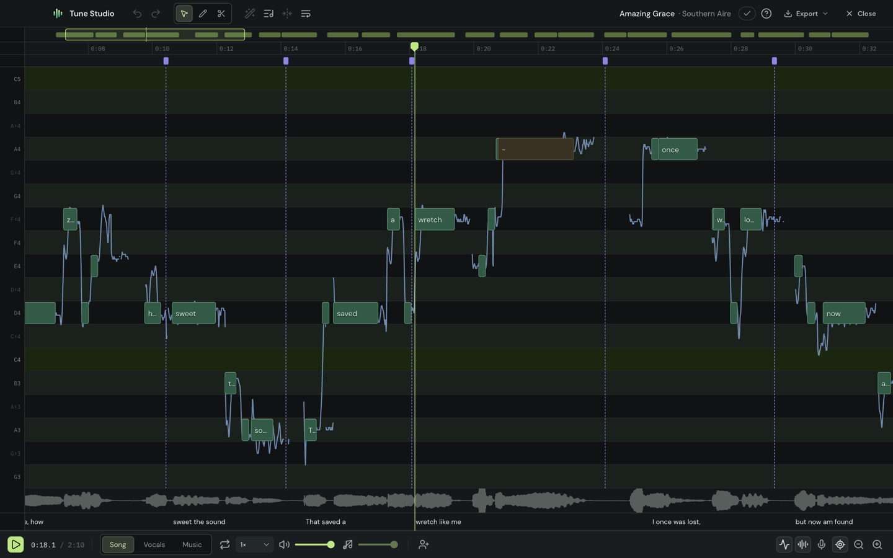
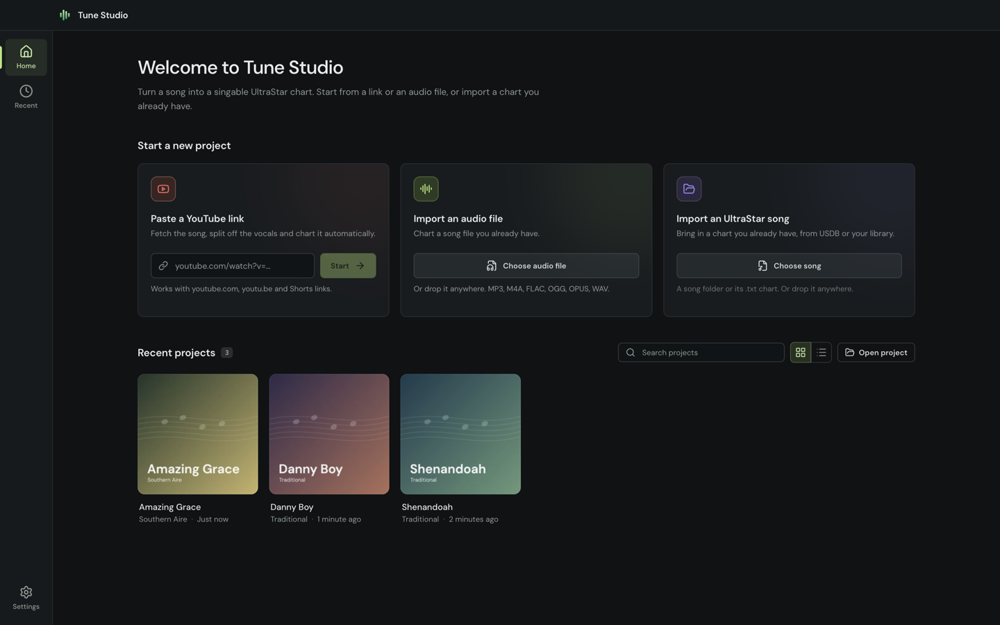

# Tune Studio

A desktop editor for UltraStar karaoke charts. Give it a song and it makes the chart for you: it separates the voice, finds the lyrics and charts the notes. Then you fine-tune it
in the editor and export it for your games or for USDB.



## What it does

- Start from a YouTube link, an audio file or an UltraStar song you already have
- Charts the song automatically: lyrics, timing, pitch and line breaks (English and German for now)
- A piano-roll editor with the sung pitch behind the notes, a waveform, undo for everything and keys for everything
- Duets, golden, rap and freestyle notes, and a list of problems to fix
- Auto pitch for the notes you select, or chart a passage again from lyrics you type
- Sing along with your microphone to check the chart
- Export a song folder for your games, or the chart as text for USDB



## Getting started

Prerequisites:

- [Bun](https://bun.sh)
- [Rust](https://rustup.rs), for the native addon that `bun run dev` builds

```bash
bun install
bun run dev
```

The app downloads the tools and models it needs the first time you use a feature. Contributors: see
[AGENTS.md](AGENTS.md) for how the project is put together and the checks a change needs.

## Credits

Tune Studio's charting uses Mel-Band RoFormer (voice separation), Whisper (hearing lyrics), FCPE (pitch), Beat This!
(tempo), GAME (notes) and an aligner fine-tuned from Meta's MMS. The GAME and MMS-derived weights are for
non-commercial use only. The app lists every model with its license in Settings.

## Training

The models Tune Studio trained itself (the aligner, its syllable-start head and the note refiners) are rebuilt,
evaluated and exported in [training/](training/README.md), a Python project of its own.

## License

[MIT](LICENSE)
